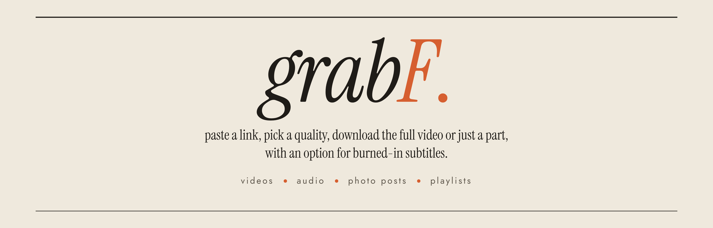

<p align="center">
  
</p>

<p align="center">
  <a href="https://github.com/firas-abidi/grabF/releases/latest"></a>
  <a href="LICENSE"></a>
  
  <a href="https://github.com/firas-abidi/grabF/releases"></a>
  <a href="tests"></a>
</p>

I made grabF because as an editor I needed one environment that downloads from any media fast, with subtitles and with no ads.
It works with youtube, tiktok, instagram, pinterest, x, soundcloud and around a thousand other sites.

<br>
<br>
<br>


## the part that i'm most excited about

burned-in subtitles. you pick a subtitle language, choose a style, and grabF draws the subtitles right into the video, so they show up everywhere you play it, no .srt file needed. there's a live preview on the video's own thumbnail so you see exactly how big they'll be before you download, and you can change the size or turn the outline off.
i looked for a downloader that does this and couldn't find one, so i built it. it also works with youtube's auto-generated captions.

ALSO you can download only a part of a video, like from 1:30 to 2:45 (i needed this feature so much)

## download

grab **grabF-setup.exe** from the [releases page](../../releases/latest), install it and open it from your desktop. it installs just for you, no admin needed, and it comes with everything it needs. windows 10 and 11.

windows will probably show "Windows protected your PC" the first time. that's only because the app isn't code-signed yet (i'm working on it). click **More info** then **Run anyway**. all the code is right here if you want to check it.

## what else it does

- every quality the site has, with the real file size next to each one
- a "plays everywhere" option if you need an mp4 that opens on any phone or editor
- audio as mp3, wav (good for editing), m4a, flac or the original file
- instagram/pinterest/other socials photo posts and carousels in full size
- whole playlists, or certain videos from a playlist
- subtitles inside the video or as a separate file too, not just burned in
- your downloads end up in Downloads\grabF, split into videos, audio and photos

## instagram photos and logins

most links work without logging in. instagram photo posts don't, instagram just doesn't show them to people who aren't logged in. so if you're logged into instagram in **firefox**, grabF uses that login by itself (only on your pc, only for that link). for other sites that need a login, pick your browser next to "signed in with" at the bottom. chrome, edge and brave lock their logins so other apps can't use them, that's why firefox works best.

## privacy

grabF doesn't collect anything. no tracking, no analytics, no account. it only talks to the site you're downloading from (including the servers that site uses for its thumbnails and video files, like i.ytimg.com for youtube), to github to check for a new version, and to python's package site to update its download engines once a week. it only reads your clipboard when you press paste.

## what it won't download

anything marked 18+, and sites that are about leaked or pirated stuff.

please only download stuff you're allowed to. what you do with grabF is on you and is only your responsibility.

## if downloading for a certain site stops working

sites change things all the time and downloaders break. grabF updates its engines by itself every week, but if something breaks before that, hit **update** at the bottom and restart when it tells you to.

full list of sites: [SUPPORTED_SITES.md](SUPPORTED_SITES.md)

## running it from the code

you need python 3.11+, ffmpeg and deno.

```
pip install "yt-dlp[default,curl-cffi]" gallery-dl pywebview
python app.py
```

it's made for windows. mac and linux will be tested and info about installing grabF on them will be available soon.

## tests

there are 170+ automated checks in the `tests` folder. the quick ones need no internet:

```
python tests/run_tests.py
```

add `--network` for the ones that download real public videos and burn real subtitles, or `--all` to also run the ones that open the window.

## thanks everyone

grabF stands on [yt-dlp](https://github.com/yt-dlp/yt-dlp) and [gallery-dl](https://github.com/mikf/gallery-dl), which do the actual downloading, plus [ffmpeg](https://ffmpeg.org), [deno](https://deno.com) and [pywebview](https://pywebview.flowrl.com). fonts are Jost, Instrument Serif and TeX Gyre Heros.

## support

if grabF saved you some time you can [buy me a coffee](https://ko-fi.com/firaspanda) ☕
found a bug or have an idea? open an [issue](../../issues).

made by [firas abidi](https://github.com/firas-abidi)

MIT license
